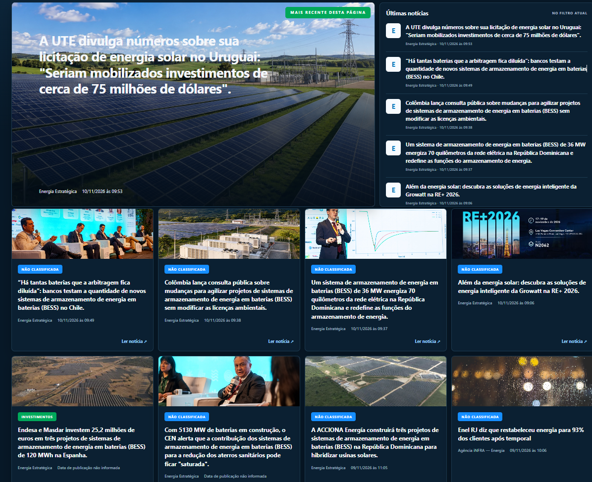

<h1 align="center">Olá! Sou João Carlos Vidal 👋</h1>

  <strong>Desenvolvedor Back-end Júnior · Ruby on Rails · C# / .NET</strong> 
  Fortaleza, Ceará · Brasil

  <a href="https://www.linkedin.com/in/carlos-vidal-129b84247/">LinkedIn</a> ·
  <a href="mailto:medeiroslima922@gmail.com">E-mail</a> ·
  <a href="https://github.com/medeiroslima922-cmyk/Portf-lio_joao">Portfólio</a>

---

## Sobre mim

Sou estudante de **Análise e Desenvolvimento de Sistemas na UNINASSAU** e desenvolvo aplicações para transformar necessidades do dia a dia em soluções com código.

Meus projetos exploram **Ruby on Rails** e **C# / .NET**, com foco em aplicações web, APIs REST, bancos de dados relacionais e regras de negócio. Também construo interfaces com HTML, CSS e JavaScript.

Busco uma oportunidade como **desenvolvedor júnior**, para contribuir com a equipe e evoluir na construção de software.

## Tecnologias que uso nos projetos

**Back-end**

  
  
  
  
  

Ruby · Ruby on Rails · C# · .NET / ASP.NET Core · Blazor

**Interface e bancos de dados**

  
  
  
  
  

HTML · CSS · JavaScript · PostgreSQL · SQLite

**Versionamento e ferramentas presentes nos repositórios**

  
  
  

Git · Docker · GitHub Actions

Também trabalho com recursos e bibliotecas como **Active Record**, **Devise**, **Hotwire (Turbo e Stimulus)**, **Entity Framework Core**, **Npgsql** e **xUnit**.

## Demonstrações de projetos com código privado

### EnergyNews · Inteligência do setor elétrico

Dashboard para acompanhar notícias do setor elétrico, com manchetes, últimas notícias, filtros e detalhes. A aplicação reúne coleta de feeds RSS/Atom, classificação de notícias e persistência em banco de dados.

**Tecnologias:** C#, .NET 10, ASP.NET Core, Blazor, Entity Framework Core e PostgreSQL. Testes com xUnit.

**Código-fonte privado.**

*Captura real do dashboard EnergyNews.*

### Controle de Gastos · Organização financeira

Aplicação web para cadastrar e organizar despesas por categoria, com autenticação de usuários e anexos de comprovantes.

**Tecnologias:** Ruby on Rails, PostgreSQL, Active Record, Active Storage e Hotwire.

**[Acessar demonstração](https://controle-gastos-8q0i.onrender.com/login)** · Código-fonte privado. O acesso começa pela tela de login.

### SempreON · Automação residencial

Site institucional para apresentar serviços e projetos de automação residencial, com galeria, navegação interativa e contato por WhatsApp.

**Tecnologias:** HTML, CSS e JavaScript.

**[Acessar demonstração](https://sempreon.vercel.app/)** · Código-fonte privado.

## Projetos públicos em destaque

| Projeto | O que você encontra | Tecnologias |
| :--- | :--- | :--- |
| [Gerenciador de tarefas](https://github.com/medeiroslima922-cmyk/blog-Rails) | Aplicação com autenticação, cadastro, busca e edição de tarefas, com prioridade e categoria. | Ruby on Rails, Devise, SQLite |
| [Desafio técnico em C#](https://github.com/medeiroslima922-cmyk/Desafio.tecnico-) | Programa de terminal para cálculo de comissões, movimentação de estoque e juros, com leitura e gravação de JSON. | C#, .NET 8, System.Text.Json |
| [Portfólio pessoal](https://github.com/medeiroslima922-cmyk/Portf-lio_joao) | Apresentação profissional com seções de habilidades, projetos e contato. | HTML, CSS, JavaScript |
| [JC Porsche](https://github.com/medeiroslima922-cmyk/Projeto-Porsch) | Vitrine de veículos com galeria de imagens, ampliação em modal e contato por WhatsApp. | HTML, CSS, JavaScript |

## Vamos conversar?

Estou aberto a oportunidades de desenvolvimento e colaboração em projetos.

**[LinkedIn](https://www.linkedin.com/in/carlos-vidal-129b84247/)** · **[medeiroslima922@gmail.com](mailto:medeiroslima922@gmail.com)**
